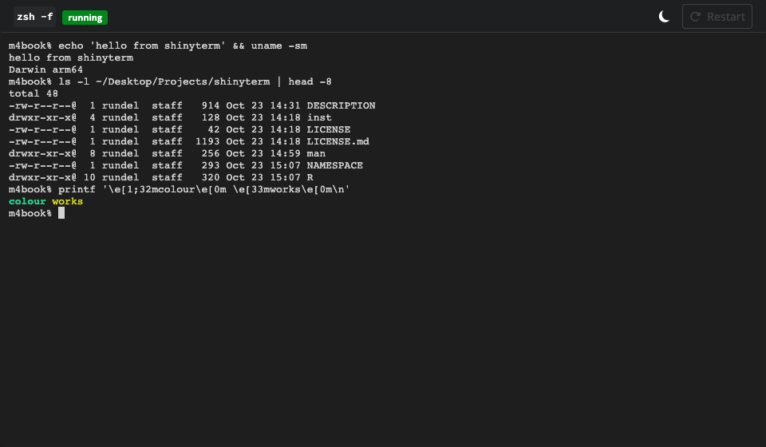
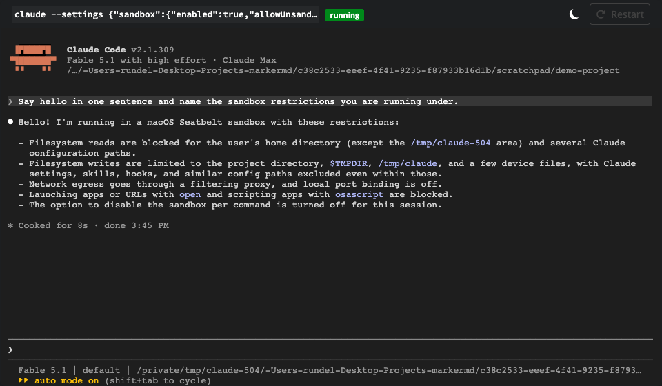
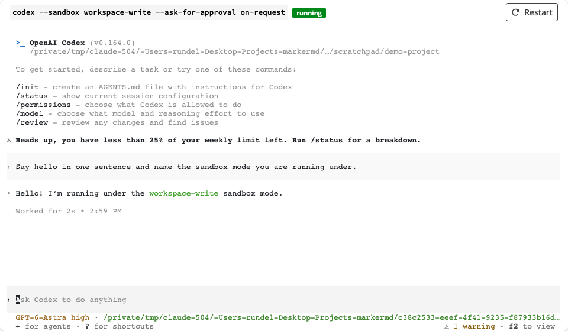

# shinyterm

# ⚠️ STOP. READ THIS BEFORE GOING ANY FURTHER. ⚠️

> ## THIS PACKAGE IS A TERRIBLE IDEA AND YOU PROBABLY SHOULD NOT USE IT.
>
> ### IT PUTS A SHELL IN A WEB PAGE.
>
> Whoever can open the app gets an interactive process running as the user
> who started it, with that user's files, credentials, SSH keys, cloud tokens
> and network access. Nothing in this package tries to stop them doing
> anything that user can do.
>
> ### THE SECURITY IMPLICATIONS HAVE NOT BEEN THOUGHT ABOUT. AT ALL.
>
> There is no authentication, no authorization, no audit log, no isolation,
> no rate limiting and no input sanitation, and none of it has been reviewed
> by anyone who knows what they are doing. It was written as a prototype for
> running agent CLIs on a laptop, for the laptop's owner, and that is the only
> situation in which it is even arguably reasonable.
>
> ### DO NOT RUN IT ON A SERVER.
>
> Not on Shiny Server, not on Posit Connect, not on shinyapps.io, not behind
> ShinyProxy, not on a cloud box, not on anything other people can reach.
> The package checks for those situations and refuses to start. If you go
> looking for a way around that check, you have been warned, in writing, in
> capital letters, and every consequence is yours.
>
> ### IF YOU USE IT ANYWAY, YOU ARE ON YOUR OWN.
>
> You use this package entirely at your own risk.

A terminal emulator for Shiny apps. `shinyterm` embeds an
[xterm.js](https://xtermjs.org) terminal in the page and connects it to a
local process running inside a pseudo-terminal (via
[processx](https://processx.r-lib.org)), so interactive command line programs,
including shells and agent CLIs such as `claude` and `codex`, run inside a
Shiny app.

## Installation

```r
# install.packages("pak")
pak::pak("rundel/shinyterm")
```

## Usage

The quickest way to try it:

```r
library(shinyterm)

terminal_app()            # your $SHELL
terminal_app("claude")    # Claude Code
terminal_app("codex", wd = "~/project")
```



In your own app, use the module pair. The UI element sizes its rows and
columns to its box; give it a height, or `height = NULL` to fill a fillable
container.

```r
library(shiny)
library(shinyterm)

ui = bslib::page_fillable(
  bslib::card(
    bslib::card_header("Claude Code"),
    bslib::card_body(padding = 0, terminal_ui("agent", height = NULL))
  )
)

server = function(input, output, session) {
  term = terminal_server("agent", "claude", wd = "~/project")

  # programmatic input, e.g. to seed a prompt
  observe(term$write("Summarise this repository\r")) |> bindEvent(input$go)
}

shinyApp(ui, server)
```

`terminal_server()` returns `start()`, `kill()`, `restart()` and `write()`
plus the reactives `alive()`, `exit_status()`, `size()` and `output()` (the
raw output transcript). Its `strip_env` argument (on by default) keeps Claude
Code and IDE markers out of the child environment; pass `FALSE` to inherit
everything or a regular expression to choose what to drop.

### Light and dark mode

The terminal ships with a light and a dark palette. By default
(`theme = "auto"`) it follows the page's Bootstrap colour mode, so adding
`bslib::input_dark_mode()` to the UI (or calling `bslib::toggle_dark_mode()`
on the server) switches the terminal live; `terminal_app()` includes the
toggle in its header and its `mode` argument picks the starting mode. Pages
without a colour mode get the dark palette. Codex reads the terminal colours
once at launch and keeps them, so `terminal_app("codex")` disables the
toggle (with a tooltip saying why) and stays in its starting mode.
`theme = "light"` or `theme = "dark"` fixes the palette, and colours in
`options$theme` override individual entries of whichever palette is active:

```r
terminal_ui("agent", theme = "light")
terminal_ui("agent", options = list(theme = list(background = "#000000")))
```

## Agent CLIs

`claude_command()` and `codex_command()` build launch specifications that turn
on the agents' own sandboxes, which is the right confinement for them: the
sandbox also governs what the agent's tools may touch, which an OS sandbox
around the terminal process cannot see. A specification can be passed wherever
a command is expected.

```r
# Claude Code confined to the project: Bash writes limited to the project and
# temp dirs, no network, reads limited to the project, no unsandboxed retries
terminal_app(claude_command(
  wd = "~/project",
  deny_read = "~/", allow_read = ".",
  permission_mode = "acceptEdits"
))

# Codex in workspace-write mode with network access
terminal_app(codex_command(wd = "~/project", network = TRUE))
```





`claude_command()` passes the sandbox as a `--settings` JSON argument (see the
[Claude Code sandboxing docs](https://code.claude.com/docs/en/sandboxing) for
the keys, any of which can be added through `settings`); `codex_command()` uses
`--sandbox`, `--ask-for-approval` and `-c` overrides. `terminal_command()`
wraps any other program.

## How it works

- The browser side is a Shiny input binding around xterm.js. Keystrokes are
  sent to the server as indexed chunks that are re-sent until acknowledged, so
  Shiny's input batching can neither drop nor duplicate them.
- The server side polls a `processx::process` started with `pty = TRUE` every
  `interval` milliseconds (50 by default) on a `later::later()` timer, outside
  the reactive graph, and pushes output to the client with
  `sendCustomMessage()`. An idle process therefore never marks the session busy.

## Limitations

- The pseudo-terminal follows the client size on unix (via `TIOCSWINSZ` on the
  pty master, which sends the process `SIGWINCH`). On Windows the process keeps
  its launch size; use `restart()` to relaunch at the new size.
- Output polling runs inside the Shiny session's event loop, so a very busy
  process competes with the rest of the app for the R process.
- A terminal gives whoever can open the app a process on the server. Only
  expose this to people you would give a shell account to, which in practice
  means yourself, on your own machine. See the warning at the top of this
  file: hosted deployments and non-localhost clients are refused.
- Requires processx 3.9.0 or later; on Windows, Windows 10 1809 or later.
- The child inherits the app's environment minus Claude Code and IDE markers
  (see `strip_env`), so a `claude` started from an app launched inside Claude
  Code or Positron behaves like one started from a plain terminal.
